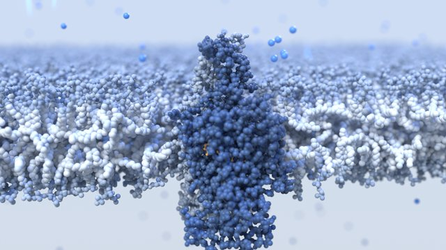
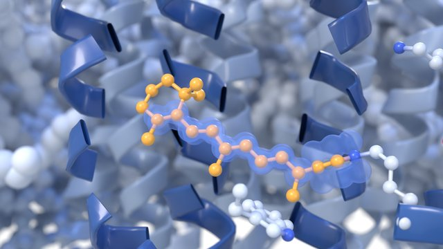
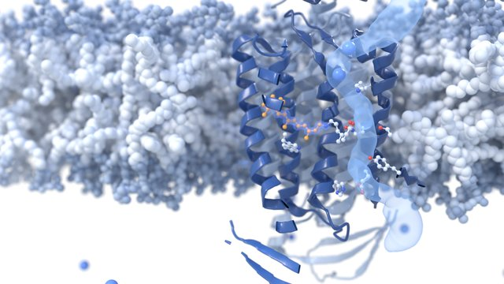
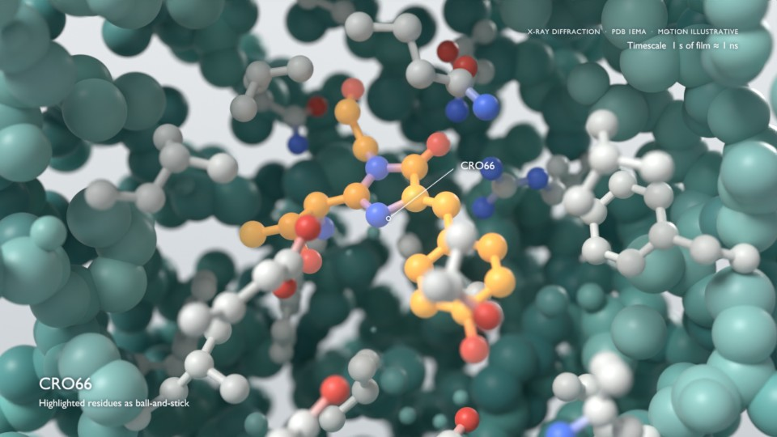

# Molecular Animation: scientific protein and molecule animation in Blender

[](https://github.com/AmadeusBio-ai/Molecular_Animation/actions/workflows/ci.yml)
[](LICENSE)

**An open-source Python framework and Blender pipeline for turning a scientific brief into an honest, beautiful molecular animation.** You hand over a request, a paper-style brief or a reference, plus structures from the Protein Data Bank or AlphaFold, and you get back a film of proteins, nucleic acids and ligands:
- a scripted Blender 5.2 scene built from PDB/mmCIF structures;
- rendered takes;
- labelled and clean MP4/WebM films with posters;
- a production record that states, beat by beat, what is experimental and what is illustrative.

It is designed to be driven by an AI agent (Claude Code through Blender MCP) and works just as well by hand.

https://github.com/user-attachments/assets/33a48c82-e1be-4c0d-ae49-af9d943b4180

*Case study: [channelrhodopsin](examples/channelrhodopsin/), from a brief on the 2026 Nobel Prize in Physiology or Medicine. A photon twists retinal, the protein responds, and a cation pathway opens. 21 s, built from PDB 9GO1/9GO2. This is version 4, drawn for a white web page (cartoons, retinal's π lobes, labels exported as data), with thermal motion at measured rates. It and a second film, [ART](projects/art-rna/) (an RNA-making reverse transcriptase locus of phage SA1, with AlphaFold Server predictions), are in the [v0.3.0 release](https://github.com/AmadeusBio-ai/Molecular_Animation/releases/tag/v0.3.0); version 3 is in [v0.2.0](https://github.com/AmadeusBio-ai/Molecular_Animation/releases/tag/v0.2.0).*

| | | |
| --- | --- | --- |
|  |  |  |

## What's inside

- **`molanim`, the framework.**
  - A pure-numpy science layer: mmCIF and assemblies, atom-matched states, constrained morphs, pathway profiles, procedural membranes, ion diffusion and transits, camera paths. It is unit-tested and runs anywhere.
  - Thermal and Brownian motion from physics ([docs/motion.md](docs/motion.md)): one clock per film, exposure-averaged frames, and molecules that move as molecules (hydrodynamic tumbling and diffusion, elastic-network normal modes, side-chain turns about bonds, lipids as bodies, worm-like DNA), at rates from the literature. Loops repeat exactly.
  - Depictions that stand for something physical ([docs/depiction-sources.md](docs/depiction-sources.md)): protein cartoons from the deposited secondary structure, nucleic acids atom by atom, van der Waals envelopes coloured by Coulombic potential, and π lobes over conjugated systems (`molanim.cartoon`, `molanim.electro`).
  - A Blender layer: sphere and ball-and-stick molecules with camera-aimed cutaways, cavity tubes, interaction markers, a studio look, a depth-of-field camera rig, and a separate label pass for captions, evidence tags, pointers and links. The same labels can be exported as data (`timeline.label_data`) for a web page to draw over the clean film.
- **`pipeline.py`.** One command line for the whole production: `new` → `build` → `still` → `preview` → `render` → `deliver`, plus `doctor`, `motion` (jump and seam detection, on stepped previews and consecutive runs), `smoke` and `check` (re-render a poster frame and compare it with the delivery).
- **A workflow and principles** for films that are both beautiful and scientifically honest: [docs/workflow.md](docs/workflow.md), [docs/principles.md](docs/principles.md), [docs/motion.md](docs/motion.md).
- **An agent guide** ([AGENTS.md](AGENTS.md)) and a `/new-film` skill for Claude Code.

## Quick start

You need Blender 5.2, a Cycles-capable GPU (NVIDIA OptiX recommended), ffmpeg with libx264 and libvpx-vp9, and Python 3.10+. The details, including Blender MCP, are in [docs/setup.md](docs/setup.md).

```
git clone https://github.com/AmadeusBio-ai/Molecular_Animation.git
cd Molecular_Animation
pip install -r requirements.txt
python pipeline.py doctor                      # Blender, GPU, ffmpeg, Python packages, structure checksums
python -m pytest tests                         # framework + case-study science, no Blender needed
```

Start a film from any PDB entry:

```
python pipeline.py new gfp --pdb 1EMA --title "Green fluorescent protein"
python pipeline.py build gfp                   # ~12 s: projects/gfp/gfp.blend
python pipeline.py still gfp 165 --percent 50  # look at it
```



*What the template produces, untouched, for 1EMA. It dives through a cutaway to the largest ligand (here the chromophore CRO66), shows its pocket as ball-and-stick, and labels the experimental method with "motion illustrative" and the clock. The protein moves in normal modes and its side chains turn about their bonds, at literature rates (1 s of film = 1 ns). Use `--loop` for a seamless orbit instead.*

From there, edit the storyboard constants at the top of `projects/gfp/gfp.py`, add what the brief needs from `molanim`, and follow the [workflow](docs/workflow.md) through preview, final render and delivery.

## Making a film from a brief with Claude Code

Open Blender with the MCP add-on running, start Claude Code in this folder, and hand it the brief:

```
/new-film path/to/your-brief.md
```

The agent follows [docs/workflow.md](docs/workflow.md):
1. **Understand.** It writes a one-page brief: the one idea, structures and evidence levels, beats, look and deliverables.
2. **Ground the science.** It fetches the PDB entries and measures the claims the film depends on.
3. **Build** the shot from the template and `molanim`.
4. **Inspect** stills, a preview contact sheet and motion statistics, including a consecutive run of the busiest moves.
5. **Refine** until it reads.
6. **Render and deliver.**
7. **Record** what was checked and how.

The case study shows the whole path from `sources/Nobel_Med_2026.md` to the delivered film.

## Repository layout

```
molanim/              the framework (pure-numpy science + molanim.blender)
pipeline.py           command-line pipeline; discovers examples/*/shots.json and projects/*/shots.json
examples/             finished case studies (channelrhodopsin)
projects/             films made with it (ART, website plates) and yours (scaffolded by `pipeline.py new`)
templates/shot/       the project scaffold
assets/pdb/           structures from RCSB + SHA256SUMS
tools/                render.py (inside Blender), encode.py, MCP smoke test, Windows MCP launcher
tests/                pytest suite (runs in CI without Blender)
docs/                 workflow, principles, motion schematic, framework API, setup, Blender 5 notes
AGENTS.md, CLAUDE.md  agent guide; .claude/skills/new-film is the /new-film skill
```

`renders/`, `delivery/` and `.blend` files are build products and are ignored by git. The delivered films are in the releases: [v0.3.0](https://github.com/AmadeusBio-ai/Molecular_Animation/releases/tag/v0.3.0) has channelrhodopsin version 4 and ART version 3 (`python pipeline.py fetch channelrhodopsin-v4`, `... fetch art-rna-v3`), [v0.2.0](https://github.com/AmadeusBio-ai/Molecular_Animation/releases/tag/v0.2.0) has version 3 (`python pipeline.py fetch channelrhodopsin`) and [v0.1.0](https://github.com/AmadeusBio-ai/Molecular_Animation/releases/tag/v0.1.0) version 1. The AlphaFold Server models behind the ART film are not distributed (AlphaFold Server Output Terms of Use); the film's delivery carries the terms.

## Reproducibility

- **Scripts are the source.** Builds are idempotent and report their numerical checks in `RESULT`. For the case study these are the retinal dihedral path, the salt-bridge distance, the worst morph bond deviation, the pathway profile, the ion clearance against the moving protein and the motion statistics.
- **Pinned inputs.** Structures are committed with checksums. Blender 5.2 is pinned. Every Blender call uses `--factory-startup`, and the GPU is selected explicitly.
- **Verified output.** `pipeline.py check` rebuilds a shot and compares a freshly rendered poster frame with the delivered one. After the case study was refactored onto `molanim`, its posters matched within 1/255 and its label frames were pixel-identical; version 3's poster still matches within 1/255 after the template's motion was generalised.

## How it relates to Molecular Nodes, PyMOL, ChimeraX and VMD

These are excellent tools and the right choice for many jobs:
- **[Molecular Nodes](https://github.com/BradyAJohnston/MolecularNodes)** is a Blender add-on for importing and styling structures, trajectories and density maps with Geometry Nodes, interactively.
- **[PyMOL](https://pymol.org), [UCSF ChimeraX](https://www.cgl.ucsf.edu/chimerax/) and [VMD](https://www.ks.uiuc.edu/Research/vmd/)** are molecular viewers and analysis programs that can also record movies.

Molecular Animation is a production pipeline rather than a viewer or an importer. A film is a Python script: storyboard constants, the brief's structural claims checked numerically, motion at literature rates, a separate label pass, and a record that tags every beat with its evidence level. It reads mmCIF with its own numpy layer and builds its geometry nodes directly, so it depends on none of the tools above. Use it for a narrative film whose claims you can trace and rebuild; use them for interactive exploration, figures and trajectory analysis.

## FAQ

### How do I animate a protein from the PDB in Blender?

Run `python pipeline.py new <name> --pdb <ID>`. It downloads the mmCIF entry from RCSB and scaffolds a working shot: a dive through a cutaway to the largest ligand, with labels, or a seamless orbit with `--loop`. Build it, look at stills, then edit the storyboard constants (see [Quick start](#quick-start)).

### Can it animate AlphaFold models?

Yes; `molanim.structure.read_mmcif` reads any mmCIF file. The [website plates](projects/website/) draw an AlphaFold DB model coloured by pLDDT, and the [ART film](projects/art-rna/) uses AlphaFold Server predictions. Show a prediction's confidence and don't animate what it doesn't support ([principles](docs/principles.md)).

### Is the motion a molecular dynamics simulation?

No. Thermal and Brownian motion is modelled, not simulated: tumbling and diffusion at hydrodynamic rates, elastic-network normal modes and side-chain turns about bonds, at rates from the literature and on one clock per film ([docs/motion.md](docs/motion.md)). Conformational changes are constrained morphs between experimental states, and the films label them as illustrative.

### How does it keep the science honest?

Every beat carries an evidence level (experimental, simulation-derived or illustrative) in the script, on screen in the labelled film, and in the production record. The brief's structural claims are measured on the structures before they are animated, because briefs, including AI-generated ones, can be wrong, and each build reports its checks in `RESULT`. See [docs/principles.md](docs/principles.md).

### Do I need an AI agent?

No. `pipeline.py` is a plain command line and every film is a Python script you can edit by hand. [AGENTS.md](AGENTS.md) and the `/new-film` skill let Claude Code, or another coding agent, run the [workflow](docs/workflow.md) through Blender MCP.

### What hardware does it need?

Blender 5.2, a Cycles-capable GPU (NVIDIA OptiX recommended) and ffmpeg. It was built and tested on Windows 11 with an RTX 5060 Ti and should work on macOS and Linux, though that is untested ([docs/setup.md](docs/setup.md)). Previews take minutes; final takes take hours.

## Citing

If you use Molecular Animation in a paper, talk or film, please cite it. [CITATION.cff](CITATION.cff) holds the metadata, and GitHub's "Cite this repository" button turns it into APA or BibTeX.

## Contributing

New case studies, framework features and portability fixes are welcome. See [CONTRIBUTING.md](CONTRIBUTING.md) and the [code of conduct](CODE_OF_CONDUCT.md).

## License and credits

- **Code and documentation:** Apache License 2.0 (`LICENSE`, `NOTICE`). © 2026 AmadeusBio.ai.
- **Structures:** from the [RCSB Protein Data Bank](https://www.rcsb.org); PDB data are CC0. The case study uses [9GO1](https://www.rcsb.org/structure/9GO1) and [9GO2](https://www.rcsb.org/structure/9GO2) (C1C2 channelrhodopsin). The website plates also use [AF-P04637-F1](https://alphafold.ebi.ac.uk/entry/P04637) from the [AlphaFold Protein Structure Database](https://alphafold.ebi.ac.uk) (CC BY 4.0).
- **Case-study brief:** generated with ChatGPT; provenance and share link in [examples/channelrhodopsin/sources/](examples/channelrhodopsin/sources/README.md).
- **Tools:** built with [Blender](https://www.blender.org) and the [Blender Lab MCP server](https://projects.blender.org/lab/blender_mcp).
